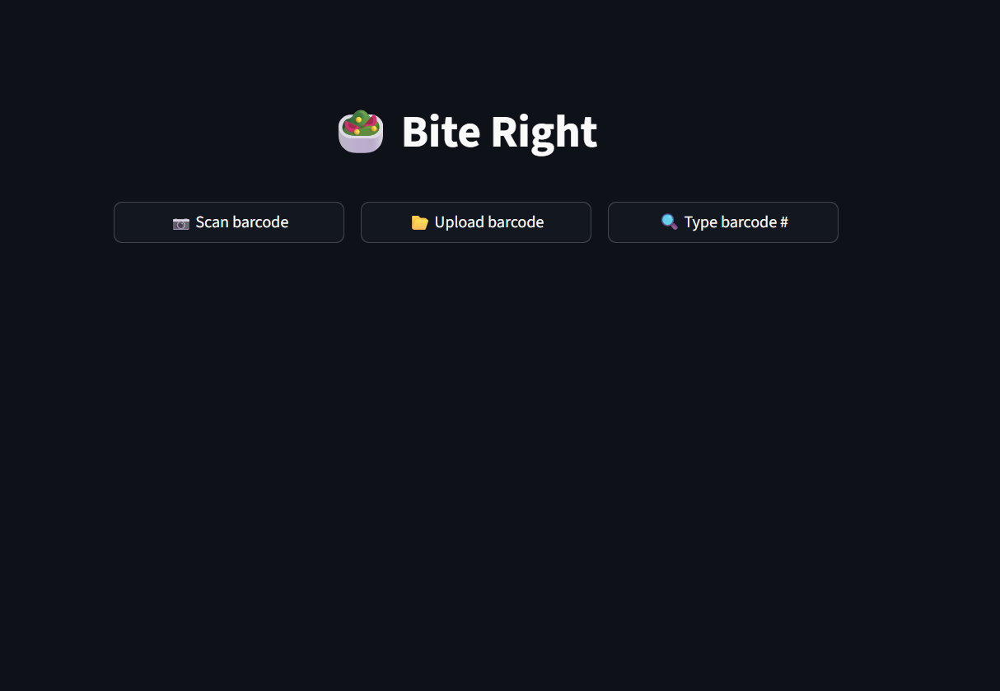
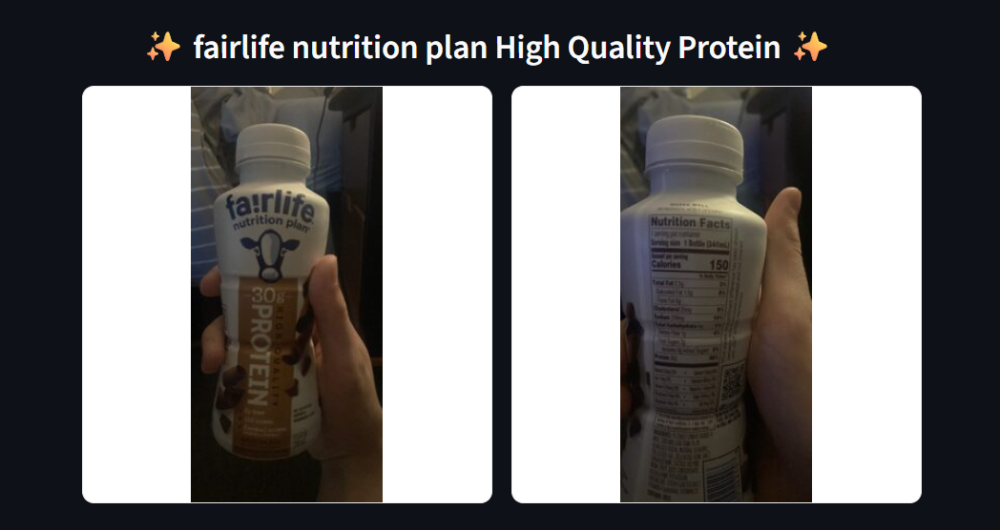
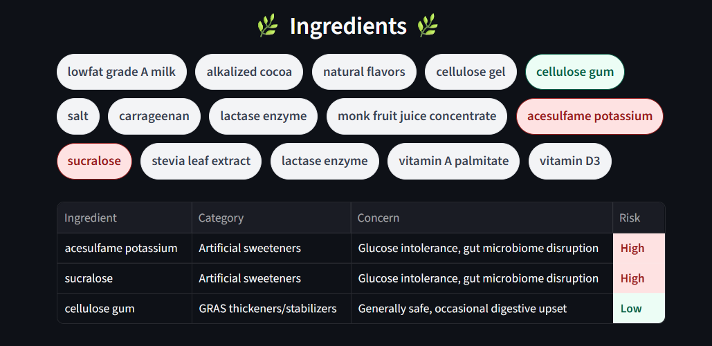
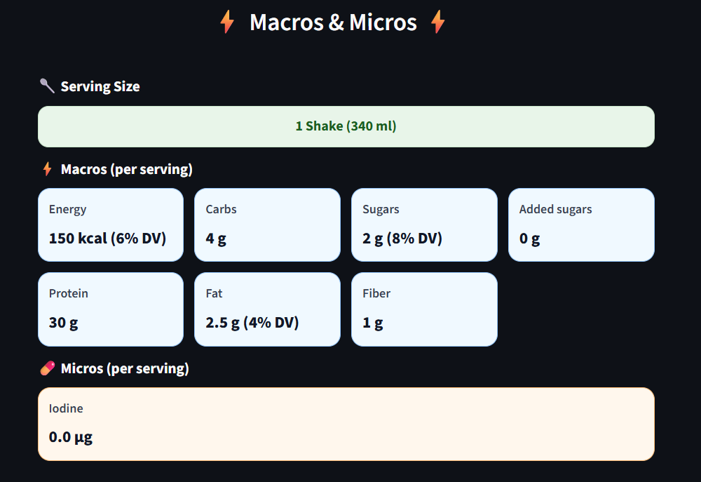

# BiteRight

**Scan a barcode, see what's really in your food.** BiteRight is a Streamlit dashboard that turns a packaged-food barcode into a colour-coded breakdown of nutrition, ingredients and ingredient risk.

[](https://biteright-app.streamlit.app/)


**[Try the live app](https://biteright-app.streamlit.app/)**

---

## Overview

I built BiteRight for my own grocery shopping, and I still use it regularly. Nutrition labels are easy to misread and ingredient lists are full of additives that are hard to judge. BiteRight reads the barcode, fetches the product from [Open Food Facts](https://world.openfoodfacts.org/), and presents the information in a form you can scan in seconds.

## Screenshots

<p align="center">
  
</p>

<p align="center">
  
</p>

<p align="center">
  
</p>

<p align="center">
  
</p>

## Features

| Feature | Details |
|---|---|
| **Three ways to enter a barcode** | Scan with the camera, upload an image, or type the number. Barcodes are decoded with `pyzbar`. |
| **Product lookup** | Name, brand, front photo and nutrition-label photo from the Open Food Facts API. |
| **Ingredient risk highlighting** | Each ingredient is matched against a curated risk list and coloured **High**, **Moderate**, **Low** or **Unknown**. |
| **Risk concern table** | Lists each flagged ingredient with its category and the reason it is flagged. |
| **Macros with % Daily Value** | Energy, carbs, sugars, added sugars, protein, fat and fibre per serving. Values are compared with your own daily targets. |
| **Micros** | Vitamins and minerals shown per serving. |
| **Serving size banner** | The serving size is shown first so the numbers can be read in context. |

## How it works

```
Barcode (camera / image / typed)
        |
        v
  pyzbar decode  --->  GTIN
        |
        v
  Open Food Facts API  --->  product, nutrition, ingredients, images
        |
        v
  Ingredient matching against harmful_ingredients_risk_list.csv
  %DV calculation against daily_values.csv
        |
        v
  Streamlit dashboard
```

## Getting started

### Prerequisites

- Python 3.10 or newer
- The ZBar system library, which `pyzbar` needs to read barcodes:
  - Debian/Ubuntu: `sudo apt-get install libzbar0 libzbar-dev` (also listed in `packages.txt` for Streamlit Cloud)
  - Windows: bundled with the `pyzbar` wheel
  - macOS: `brew install zbar`

### Install and run

```bash
git clone https://github.com/Gaurang111/biteRight.git
cd biteRight

python -m venv venv
# Windows: venv\Scripts\activate
source venv/bin/activate

pip install -r requirements.txt
streamlit run main.py
```

The app opens at `http://localhost:8501`. Sample barcode images (`barcode.jpg`, `barcode2.jpg`, `barcode3.jpg`) are included for testing the upload option.

## Configuration

Two CSV files drive the personalised parts of the app. Edit them to suit you.

| File | Purpose |
|---|---|
| `harmful_ingredients_risk_list.csv` | Maps ingredient names and aliases to a category, a risk level and the main concern. |
| `daily_values.csv` | Your daily targets (calories, fat, saturated fat, sugar, sodium and so on), used to compute %DV. |

## Project structure

```
biteRight/
├── main.py                            # Streamlit UI and display logic
├── source.py                          # Barcode decoding and Open Food Facts lookup
├── harmful_ingredients_risk_list.csv  # Ingredient risk reference data
├── daily_values.csv                   # Personal daily-value targets
├── output_images/                     # Screenshots used in this README
├── barcode*.jpg                       # Sample barcodes for testing
├── packages.txt                       # System packages for Streamlit Cloud
└── requirements.txt
```

## Tech stack

Python, Streamlit, pandas, requests, Pillow, pyzbar, Open Food Facts API.

## Limitations

- Results depend on how complete the Open Food Facts entry is. Some products lack nutrition or ingredient data.
- The ingredient risk list is a simple reference, not medical advice. Check with a qualified professional for health decisions.

## Data sources

Product data comes from [Open Food Facts](https://world.openfoodfacts.org/), a community database released under the Open Database Licence.
